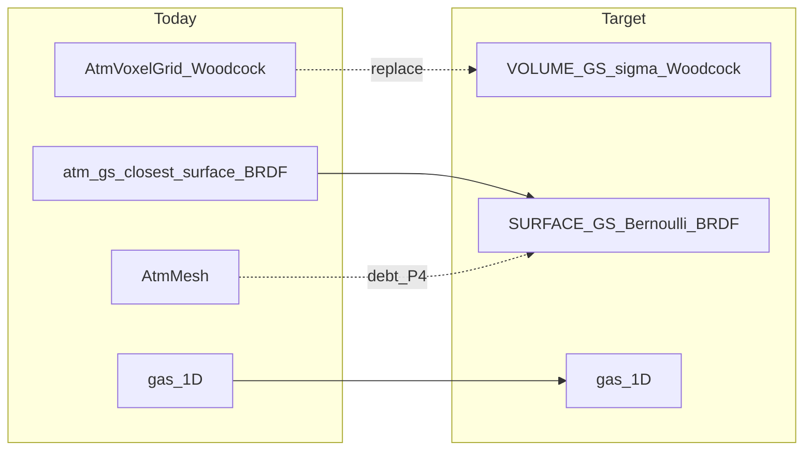

# GS 替代全部图元计划 / Plan: Replace All Primitives with GS

> Status: **design only (P0)**. No volume-GS backend is implemented yet.
> 状态：**仅设计（P0）**。体积 GS 后端尚未实现。
>
> Branch: `feat/gs`

## 1. Goal / 目标

**中：** 用**一套**高斯缓冲统一场景图元：

| 角色 | 今日实现 | 目标 |
| -- | -- | -- |
| 云（参与介质） | `AtmVoxelGrid` + Woodcock | **VOLUME GS**：σ 场 + Woodcock + 相位 |
| 山/地（表面） | 表面 GS Bernoulli + BRDF | **SURFACE GS**（已有，保持） |
| Mesh 地面（沙漠三角等） | `AtmMesh` / OptiX mesh | **债项**：评估表面 GS 替换；不假装已完成 |
| 1D 气 | 垂直层结 | **不替换**（仍与云 race） |

**EN:** Unify scene primitives on **one** Gaussian buffer: VOLUME GS for cloud medium; SURFACE GS for terrain (already); mesh ground is an open debt; 1D gas stays.

**禁止 / Forbidden:** 把有序 α 合成、或给表面 GS「改个材质字段」包装成已对齐 htrdr 的云多次散射。验收必须定量，禁止目测交差。

## 2. Why surface GS is not volume cloud / 为何表面 GS ≠ 云介质

**中：** 经典 / 非大气 `pathTracer` 的 \(T\leftarrow T(1-\alpha)\)、\(C\leftarrow C+T\alpha c\) **是**体渲染图像形成；\(\alpha=1-e^{-\sigma\delta}\) 时透过率积即离散 Beer–Lambert。**同意：GS 透过率适合做体渲染。**

大气路径里 [`atm_gs_closest_surface`](../gpu/threedgptir_tracer/include/3dgptir/kernels/cuda/atmospherePathTracer.cuh) 却是：随机 α 接受为**最近表面**，再 BRDF。注释写明 *Stochastic α is the object model, not cloud k*。这是山地表面化，不是云体积 MC。

云体积 MC 需要：连续 \(\sigma_e(x)\)、majorant、Woodcock 自由程、HG/Mie、与 1D 气竞争、体积 NEE Tr。体素今日提供这些；VOLUME GS 必须**实现同一类算子**，不是复用表面命中。

**EN:** GS transmittance compositing is valid volume rendering in graphics. Atm path surface-izes GS on purpose. Cloud MC needs σ-field + Woodcock + phase + gas race — VOLUME GS must implement that operator class.



## 3. Unified buffer and type rule / 统一缓冲与定型

布局见 [`particleDensity.h`](../gpu/threedgptir_tracer/include/3dgptir/particleDensity.h)：

```cpp
struct ParticleDensity {
    float3 position;
    float  density;     // SURFACE: opacity weight; VOLUME: w_i or σ_i
    float4 quaternion;
    float3 scale;
    float  padding;     // unused for type — do not pack flags here
};
```

Plus `particleMaterial` (albedo, roughness, **metallic**) and `particleShadingNormal`.

### Type rule（采用）

```text
metallic < 0   →  VOLUME     (sentinel: metallic = -1.f)
metallic ≥ 0   →  SURFACE    (metallic ∈ [0, 1] for BRDF)
```

| Signal | Role |
| -- | -- |
| `metallic < 0` | **Sole type flag** |
| `|n|² < ε` | VOLUME writes `(0,0,0)`; checksum only |
| `padding` | **Unused for type** |

**Why not `|n|` alone:** surface path already falls back when normal is missing/tiny (`-ray.dir`). Training can zero normals. Fragile.

**Why not padding bits:** unclear vs uninitialized floats; illegal BRDF metallic is a clearer spare semantic (metal must be ≥ 0 for BRDF).

### Slot packing / 槽位

```text
VOLUME:
  density              → w_i or σ_i (document one convention)
  metallic             → -1.f (frozen; not optimized)
  albedo / roughness    → ω (σ_s/σ_e), g (HG), σ_a as documented
  shadingNormal        → (0,0,0)

SURFACE:
  existing density / material / normal semantics
  metallic             → clamp to [0, 1] before BRDF
```

One BVH from position/scale/quat for all particles. Runtime branches on metallic after particleId is known.

## 4. Volume GS transport / 体积 GS 传输

### 4.1 Field

Each VOLUME Gaussian \(i\) carries center \(c_i\), scale/covariance, and extinction amplitude \(\sigma_i\):

\[
\sigma(x)=\sum_i \sigma_i\,G_i(x),\quad
G_i(x)=\exp\!\Big(-\frac{\|x-c_i\|^2}{2r_i^2}\Big)
\]

(Anisotropic \(G_i\) via quaternion+scale as in existing kernels.) Far kernels \(G_i\approx 0\) are dropped via BVH.

### 4.2 Correct sampling order

```text
define σ(x) from VOLUME GS
→ build brick majorants σ̄_b
→ Woodcock / delta tracking → free path t
→ at x+tω sample phase p (HG/Mie)
```

**Inverted (wrong):** sample \(t\) then “spawn” a GS / use anyhit as surface hit.

**anyhit / BVH role:** accelerate “which Gaussians contribute at \(x\) or intersect brick \(b\)” — **not** Bernoulli surface acceptance for VOLUME particles.

### 4.3 Two BVH query modes (same tree)

1. **Point query:** which AABBs contain \(x\) → sum \(\sigma_i G_i(x)\).
2. **Region query:** which Gaussians intersect brick \(b\) → `near(b)` → majorant.

### 4.4 Majorant（重要纠正）

True extinction uses \(G_i\) weights. A brick majorant

\[
\bar\sigma_b=\sum_{i\in\mathrm{near}(b)}\sigma_i
\]

is **valid** (\(G_i\le 1\)) but **often loose**: grazing kernels still enter `near(b)` at full \(\sigma_i\). Woodcock accepts with \(\sigma(x)/\bar\sigma_b\); small numerator + fat denominator ⇒ **more null collisions**, not fewer.

**Adopted bound:**

\[
\bar\sigma_b=\sum_{i\in\mathrm{near}(b)}\sigma_i\,\max_{x\in b}G_i(x)
\]

(still valid since \(\max\sum\le\sum\max\)). Coarse brick table stores only \(\bar\sigma_b\) — a **majorant accel**, not a return to fine voxel media. Truth \(\sigma(x)\) remains the GS sum.

### 4.5 Race with existing atmosphere MC

VOLUME path must plug into the same machinery as voxels today:

- Race with 1D gas
- SW: \(K_s\) walk + analog \(\mathrm{Tr}(K_a)\) where applicable
- LW: \(K_{\mathrm{ext}}\) + scatter/absorb Bernoulli \(\omega\)
- Sun NEE: volume transmittance through \(\sigma_e\)
- Phase: HG/Mie on **volume** events, not surface BRDF

Keep a **voxel path switch** until A/B metrics pass. Do not delete voxel Woodcock in the first merge.

SURFACE events remain `min(t_surface, …)` vs volume free path — VOLUME particles never take the Bernoulli surface branch.

## 5. Technical defects（诚实清单 / Honest defect list）

These are **open**. None are solved by this document.

1. **No VOLUME backend yet.** Atmosphere still uses `atm_woodcock_voxels_*` + `atm_gs_closest_surface`. `metallic < 0` is a convention only until code exists.

2. **Majorant tightness unknown.** \(\sum\sigma_i\max_b G_i\) helps vs \(\sum\sigma_i\); null-collision rate in thick cloud is unmeasured. May need hierarchical majorants.

3. **Point σ(x) cost.** Every candidate collision (including nulls) needs BVH + sum of overlapping kernels — typically more expensive than one voxel fetch.

4. **HTCP → GS fit.** Liquid-water fields are native voxels. Fitting/compressing to Gaussians adds error. Must quantify vs htrdr; **no eyeball acceptance**.

5. **Gas / spectral / NEE wiring.** VOLUME σ must feed existing race, SW/LW walks, and volume sun Tr — not a toy second path that skips physics.

6. **Shared buffer constraints.** Training must freeze VOLUME `metallic=-1`, mask normal losses on VOLUME, and project SURFACE metallic into [0,1] so optimizers cannot flip types.

7. **Mesh ground / -R slab.** Desert two-triangle mesh and mesh-repeat slab logic remain. Replacing mesh with SURFACE GS touches known ground-hit failure modes (workspace rule: do not casually rewrite ground path). Track as **P4**, separate from cloud VOLUME work.

8. **OptiX cache / kernel rev.** Kernel changes require wiping OptiX disk cache and bumping `ATM_KERNEL_REV`. Do not mix stale surface anyhit semantics with volume σ queries.

9. **No replacement claim without A/B.** Until voxel-off / GS-cloud-on comparisons with agreed metrics (and htrdr where applicable), **do not claim voxels are replaced**.

## 6. Non-goals / 非目标

- Do not insert GS pointers into `AtmVoxelGrid` / `AtmParams` (ABI / layout shift).
- Do not rename surface Bernoulli as “volume MC”.
- Do not commit `scenes/**` png/npy/ppm dumps as progress.
- Do not add `ATM_WRAP_XY` or rewrite ground triangle code under this plan’s cloud work.
- Do not replace 1D gas with GS.

## 7. Phased roadmap / 阶段

| Phase | Deliverable | Exit criterion |
| -- | -- | -- |
| **P0** (this commit) | This doc + branch `feat/gs` | Doc merged to branch; defects listed |
| **P1** | VOLUME convention in loaders; σ(x) query; brick majorant precompute; voxel path still default | Unit tests: σ query vs brute sum; majorant ≥ max σ on brick samples |
| **P2** | Woodcock on σ_GS + gas race; feature flag | Same scene: voxel vs GS-cloud radiance metrics within agreed tolerance **or** documented gap |
| **P3** | HTCP→GS fit pipeline + htrdr comparison | Quantitative report; no “looks cloudy” sign-off |
| **P4** | Evaluate mesh→SURFACE GS | Separate design; respect ground-hit known-good rules |

## 8. Code touchpoints (future, not this commit)

- [`atmospherePathTracer.cuh`](../gpu/threedgptir_tracer/include/3dgptir/kernels/cuda/atmospherePathTracer.cuh) — four-way min(t); SURFACE vs VOLUME branch
- [`atmosphere.cuh`](../gpu/threedgptir_tracer/include/3dgptir/kernels/cuda/atmosphere.cuh) — Woodcock; will need GS σ backend alongside voxels
- [`atmosphere.h`](../gpu/threedgptir_tracer/include/3dgptir/atmosphere.h) — params; avoid layout sabotage
- [`particleDensity.h`](../gpu/threedgptir_tracer/include/3dgptir/particleDensity.h) — buffer layout (unchanged for type)
- [`gaussianParticles.cuh`](../gpu/threedgptir_tracer/include/3dgptir/kernels/cuda/gaussianParticles.cuh) — kernel response / G_i

## 9. Related docs

- [methods.md](methods.md) — voxel Woodcock, gas, Mie
- [diff.md](diff.md) — GPU vs htrdr deltas
- Workspace rule: ground hit known-good (`/tmp/cloudgs_atm_backup2/`) — do not break while adding VOLUME cloud
