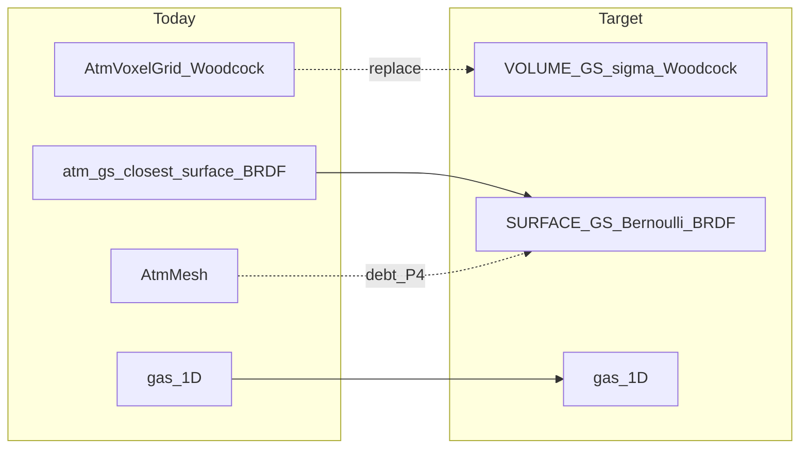

# GS 替代全部图元计划 / Plan: Replace All Primitives with GS

> Status: **design only (P0 + doc refine)**. No volume-GS backend / no CUDA changes yet.
> 状态：**仅设计（P0 + 文档完善）**。尚无体积 GS 后端，**未改 CUDA**。
>
> Branch: `feat/gs`
>
> Open decisions (do not invent in code): see §10.

## 1. Goal / 目标

**中：** 用**一套**高斯缓冲统一场景图元：

| 角色 | 今日实现 | 目标 |
| -- | -- | -- |
| 云（参与介质） | `AtmVoxelGrid` + Woodcock | **VOLUME GS**：σ 场 + Woodcock + 相位 |
| 山/地（表面） | 表面 GS Bernoulli + BRDF | **SURFACE GS**（已有，保持） |
| Mesh 地面（沙漠三角等） | `AtmMesh` / OptiX mesh | **债项**：评估表面 GS 替换；不假装已完成 |
| 1D 气 | 垂直层结 | **不替换**（仍与云 race） |

**EN:** Unify scene primitives on **one** Gaussian buffer: VOLUME GS for cloud medium; SURFACE GS for terrain (already); mesh ground is an open debt; 1D gas stays.

**禁止 / Forbidden:** 把有序 α 合成、或给表面 GS「改个材质字段」包装成已对齐 htrdr 的云多次散射。验收必须定量，禁止目测交差。

## 2. Why surface GS is not volume cloud / 为何表面 GS ≠ 云介质

**中：** 经典 / 非大气 `pathTracer` 的 \(T\leftarrow T(1-\alpha)\)、\(C\leftarrow C+T\alpha c\) **是**体渲染图像形成；\(\alpha=1-e^{-\sigma\delta}\) 时透过率积即离散 Beer–Lambert。**同意：GS 透过率适合做体渲染。**

大气路径里 [`atm_gs_closest_surface`](../gpu/threedgptir_tracer/include/3dgptir/kernels/cuda/atmospherePathTracer.cuh) 却是：随机 α 接受为**最近表面**，再 BRDF。注释写明 *Stochastic α is the object model, not cloud k*。这是山地表面化，不是云体积 MC。

云体积 MC 需要：连续 \(\sigma_e(x)\)、majorant、Woodcock 自由程、HG/Mie、与 1D 气竞争、体积 NEE Tr。体素今日提供这些；VOLUME GS 必须**实现同一类算子**，不是复用表面命中。

**EN:** GS transmittance compositing is valid volume rendering in graphics. Atm path surface-izes GS on purpose. Cloud MC needs σ-field + Woodcock + phase + gas race — VOLUME GS must implement that operator class.



## 3. Unified buffer and type rule / 统一缓冲与定型

布局见 [`particleDensity.h`](../gpu/threedgptir_tracer/include/3dgptir/particleDensity.h)：

```cpp
struct ParticleDensity {
    float3 position;
    float  density;     // SURFACE: opacity weight; VOLUME: σ_i (O1 locked)
    float4 quaternion;
    float3 scale;
    float  padding;     // unused for type — do not pack flags here
};
```

Plus `particleMaterial` (albedo, roughness, **metallic**) and `particleShadingNormal`.

### Type rule（采用）

```text
metallic < 0   →  VOLUME     (sentinel: metallic = -1.f)
metallic ≥ 0   →  SURFACE    (metallic ∈ [0, 1] for BRDF)
```

| Signal | Role |
| -- | -- |
| `metallic < 0` | **Sole type flag** |
| `|n|² < ε` | VOLUME writes `(0,0,0)`; checksum only |
| `padding` | **Unused for type** |

**Why not `|n|` alone:** surface path already falls back when normal is missing/tiny (`-ray.dir`). Training can zero normals. Fragile.

**Why not padding bits:** unclear vs uninitialized floats; illegal BRDF metallic is a clearer spare semantic (metal must be ≥ 0 for BRDF).

### O1 locked: VOLUME `density` = \(\sigma_i\) / 已锁定

**中：** VOLUME 粒子的 `density` **就是**该高斯的消光振幅 \(\sigma_i\)（单位与体素 `ka+ks` 相同，\({\mathrm{m}}^{-1}\)）。场为

\[
\sigma_e(x)=\sum_i \sigma_i\,G_i(x),\quad G_i(c_i)=1.
\]

**不采用** 全局 `sigma_ref` × \(w_i\)：少一层间接、P1 校验直接、与体素格点 \(k\) 对照更干净。谱段 Mie 缩放仍走现有 runtime 乘数（与体素路径一致），**不要**再塞第二个全局 ref。

**EN:** VOLUME `density` **is** \(\sigma_i\) (same units as voxel extinction). No global `sigma_ref`×\(w_i\). Spectral Mie scales stay as runtime multipliers like the voxel path.

SURFACE `density` 语义不变（进 galpha），与 VOLUME **同字段异义**，靠 `metallic<0` 分支。

### Slot packing / 槽位

```text
VOLUME (O1 + O2 locked):
  density              → σ_i = k_a + k_s     (m^-1; from voxel at extract)
  metallic             → -1.f                (sole type flag)
  roughness            → g                   (HG asymmetry; see below)
  albedo.x             → k_a                 (AtmVoxelGrid.ka)
  albedo.y             → k_s                 (AtmVoxelGrid.ks)
  albedo.z             → temperature (K)     (AtmVoxelGrid.temperature; 0 if absent)
  shadingNormal        → (0,0,0)

  derived:
    ω = k_s / max(k_a + k_s, ε)
    σ_e ↔ density (extract tolerance)

SURFACE:
  existing density / material / normal
  metallic, roughness ∈ [0, 1]
```

### HG \(g\): 是什么、哪里来、能否放 `roughness`

**是什么：** Henyey–Greenstein 相函数的不对称因子，\(g\in(-1,1)\)。云滴前向散射时常 \(g\sim 0.7\text{–}0.9\)。体积碰撞后用 `atm_hg_phase(g, μ)` 抽样方向（本库短波云侧已是 HG，不是把完整 Mie 相函数 LUT 逐相位用上）。

**哪里来（与现体素路径一致）：**

- **不是** `AtmVoxelGrid` 字段（体素只有 `ka/ks/T`）。
- 来自 **htmie / Mie LUT**：按波长或谱段取 \(g(\lambda)\) 或谱段代表值。现核在绑路径时写 `atm->mie_g`（见 `atmosphere.cuh` 对 `mie_g_nm` 的插值；截面则用 `mie_cs_band` / `mie_ca_band` 缩放体素 \(k\)）。
- 钉扎提取：可写入**提取时刻**的场景默认 \(g\)（或参考波长 \(g\)）；P2 更干净的做法是 **运行时仍读全局/谱段 `mie_g`**，粒子上的 `roughness` 仅作可选覆盖或缓存。

**能否放 `roughness`：可以。**

| | |
| -- | -- |
| 定型 | 仍只用 **`metallic < 0`**（不要再用 `roughness=-1` 当类型） |
| `roughness` | VOLUME：存 \(g\in(-1,1)\)；SURFACE：BRDF 粗糙度 \(\in[0,1]\) |
| 冲突 | HG 的 \(g\) 也可接近 0，与「缺省」无冲突；**禁止**再要求 VOLUME `roughness=-1` |
| 校验 | VOLUME ⇒ `metallic < 0` 且 `|roughness| < 1`（严格小于 1） |

**推荐运行时优先级（写入计划，P2 实现时遵守）：** 若路径已绑 `mie_g`（谱采样后），**以路径 `mie_g` 为准**（与体素云一致）；粒子 `roughness` 用于无谱路径、调试钉扎、或显式 per-particle 各向异性实验。避免「粒子 g」与「路径 mie_g」 silently 不一致。

One BVH from position/scale/quat. Type branch: `metallic < 0` only.


### Voxel grid → VOLUME GS 预提取 / Pre-extract from voxels

**中：可以。** 体积 GS **不是**必须从影像学出来；宿主可从现有 `AtmVoxelGrid`（`ka`/`ks`）**离线预计算**出 VOLUME 粒子，供 P1 校验与日后 P2 对照。这是数据管线，不是运行时 Woodcock 里再扫全体素。

| 层级 | 做法 | 用途 | 诚实边界 |
| -- | -- | -- | -- |
| **P1 钉扎提取** | 活跃体素 → 一粒：`density=k_a+k_s`；`albedo=(k_a,k_s,T)`；`metallic=-1`；`roughness=g_scene`（或提取时 Mie 参考 g）；`n=0`；scale≈dx | 测 σ / ka / ks | 重叠 bias；g 与路径 mie_g 对齐策略见上 |
| **P3 拟合提取** | 对 LWC 或 \(k_e\) 场做高斯混合拟合/压缩 | 真压缩表示 | 拟合残差进 A3.* |

钉扎提取时 \(\sigma_i\) 与 \(G_i\) 宽度必须**联立**约定（例如要求单核在 \(c_i\) 贡献 \(\sigma_i=\sigma_e^{\mathrm{vox}}(c_i)\)，重叠区求和会 **偏高**——验收里要报告该 bias，禁止假装无偏重建体素场）。

```text
Host (offline):
  AtmVoxelGrid ka,ks
    → filter active cells
    → emit VOLUME ParticleDensity/Material
    → volume_gs_build_majorants(...)
P1 tests: σ_query vs brute; majorant ≥ σ
P2: same assets under cloud_medium=volume_gs vs voxels (expect gap from pin extraction)
P3: replace pin with fit; shrink gap; htrdr metrics
```

**EN:** Yes — pre-extract VOLUME GS from the voxel grid offline. P1 uses a **pin** (one Gaussian per active cell) for testable σ; P3 uses a real **fit**. Pin overlap bias must be reported; not a free lossless replace.

## 4. Volume GS transport / 体积 GS 传输

### 4.1 Field

Each VOLUME Gaussian \(i\) carries center \(c_i\), scale/covariance, and extinction amplitude \(\sigma_i\):

\[
\sigma(x)=\sum_i \sigma_i\,G_i(x),\quad
G_i(x)=\exp\!\Big(-\frac{\|x-c_i\|^2}{2r_i^2}\Big)
\]

(Anisotropic \(G_i\) via quaternion+scale as in existing kernels.) Far kernels \(G_i\approx 0\) are dropped via BVH.

### 4.2 Correct sampling order

```text
define σ(x) from VOLUME GS
→ build brick majorants σ̄_b
→ Woodcock / delta tracking → free path t
→ at x+tω sample phase p (HG/Mie)
```

**Inverted (wrong):** sample \(t\) then “spawn” a GS / use anyhit as surface hit.

**anyhit / BVH role:** accelerate “which Gaussians contribute at \(x\) or intersect brick \(b\)” — **not** Bernoulli surface acceptance for VOLUME particles.

### 4.3 Two BVH query modes (same tree)

1. **Point query:** which AABBs contain \(x\) → sum \(\sigma_i G_i(x)\).
2. **Region query:** which Gaussians intersect brick \(b\) → `near(b)` → majorant.

### 4.4 Majorant（重要纠正）

True extinction uses \(G_i\) weights. A brick majorant

\[
\bar\sigma_b=\sum_{i\in\mathrm{near}(b)}\sigma_i
\]

is **valid** (\(G_i\le 1\)) but **often loose**: grazing kernels still enter `near(b)` at full \(\sigma_i\). Woodcock accepts with \(\sigma(x)/\bar\sigma_b\); small numerator + fat denominator ⇒ **more null collisions**, not fewer.

**Adopted bound:**

\[
\bar\sigma_b=\sum_{i\in\mathrm{near}(b)}\sigma_i\,\max_{x\in b}G_i(x)
\]

(still valid since \(\max\sum\le\sum\max\)). Coarse brick table stores only \(\bar\sigma_b\) — a **majorant accel**, not a return to fine voxel media. Truth \(\sigma(x)\) remains the GS sum.

### 4.5 Race with existing atmosphere MC

VOLUME path must plug into the same machinery as voxels today:

- Race with 1D gas
- SW: \(K_s\) walk + analog \(\mathrm{Tr}(K_a)\) where applicable
- LW: \(K_{\mathrm{ext}}\) + scatter/absorb Bernoulli \(\omega\)
- Sun NEE: volume transmittance through \(\sigma_e\)
- Phase: HG/Mie on **volume** events, not surface BRDF

Keep a **voxel path switch** until A/B metrics pass. Do not delete voxel Woodcock in the first merge.

SURFACE events remain `min(t_surface, …)` vs volume free path — VOLUME particles never take the Bernoulli surface branch.

## 5. Technical defects + priority / 缺陷与优先级

These are **open**. None are solved by this document. Priority = when it blocks shipping a honest VOLUME cloud path.

| ID | Defect | Priority | Blocks | Phase to face |
| -- | -- | -- | -- | -- |
| D1 | No VOLUME backend (`atm_woodcock_voxels_*` + surface GS only); `metallic<0` is convention only | **P0** (fact) | everything | P1–P2 |
| D2 | Majorant tightness / null rate unknown even with \(\sum\sigma_i\max_b G_i\) | **P0** | P2 perf & practicality | P1 measure → P2 |
| D3 | Point \(\sigma(x)\) cost (BVH + sum per candidate, incl. nulls) | **P1** | P2 wall time | P1 bench → P2 |
| D4 | HTCP → GS fit error vs native LWC voxels | **P0** for “replace voxels” claim | P3 legitimacy | P3 |
| D5 | Gas race / SW·LW walks / volume NEE Tr must use \(\sigma_{\mathrm{GS}}\) | **P0** | physical parity | P2 |
| D6 | Shared buffer: freeze VOLUME metal=-1; SURFACE metal∈[0,1]; mask VOLUME normal loss | **P1** | training / authoring | P1 loaders |
| D7 | Mesh ground / -R slab; ground-hit known-good rules | **P2** (defer) | mesh replacement only | **P4 only** |
| D8 | OptiX cache + `ATM_KERNEL_REV` on kernel change | **P1** process | silent wrong images | every CUDA change |
| D9 | No A/B ⇒ no “replaced” claim | **P0** policy | communications | P2+ |

**Priority legend:** P0 = must not lie / must design for; P1 = before or with first code; P2 = can wait until mesh work.

## 6. Acceptance criteria / 验收标准

No phase is “done” by screenshots alone.

### 6.1 P1 exit (host / offline; **no atmosphere kernel swap required**)

| ID | Criterion | Pass |
| -- | -- | -- |
| A1.1 | Type rule documented + loader/writer can emit VOLUME with `metallic=-1`, `n=0` | Round-trip fixture |
| A1.2 | \(\sigma(x)\) query vs brute force over all VOLUME particles | \(\max\|\sigma_{\mathrm{q}}-\sigma_{\mathrm{brute}}\| / \max(\sigma_{\mathrm{brute}},\varepsilon) \le 10^{-4}\) on ≥1e3 random probes (or documented float mode) |
| A1.3 | Brick majorant validity | For ≥1e3 random samples \(x\in b\): \(\sigma(x) \le \bar\sigma_b (1+10^{-4})\) |
| A1.4 | Majorant tightness **reported** on **fire** pin cloud | Log median / p95 of \(\bar\sigma_b / \max_{x\in b}\sigma(x)\); **no pass/fail threshold until measured** |
| A1.5 | Voxel path remains default | Flag off ⇒ bit-identical / CUDA untouched (P1) |
| A1.6 | §10 decisions resolved or TBD with no code using them | Checklist |
| A1.7 | Fire pin extract runs end-to-end (O3) | From `scenes/fire_gs` voxel assets → VOLUME particles → A1.2–A1.4 on that set; report overlap bias vs voxel \(k_e\) |

### 6.2 P2 exit (device Woodcock on \(\sigma_{\mathrm{GS}}\) + gas race; feature flag)

| ID | Criterion | Pass |
| -- | -- | -- |
| A2.1 | Feature flag: `cloud_medium = voxels \| volume_gs` | Default = voxels |
| A2.2 | Same camera / sun / gas / spp: voxel vs volume_gs beauty (or mono band) | Publish mean, relRMSE / MAPE on finite pixels; **tolerance TBD in §10** — until set, only “report gap”, never “pass” |
| A2.3 | Null-collision stats under volume_gs | Report mean nulls/path; if unusable, stop and tighten majorant — do not ship |
| A2.4 | OptiX cache wiped + `ATM_KERNEL_REV` bumped | Checklist signed in PR |
| A2.5 | SURFACE GS / mesh ground unchanged under voxel default | Mountain/desert regression vs known-good policy |

### 6.3 P3 exit (HTCP fit + htrdr)

| ID | Criterion | Pass |
| -- | -- | -- |
| A3.1 | Fit residual on LWC or \(\sigma\) field quantified | Table in report |
| A3.2 | htrdr comparison on agreed scene/band | Same metrics family as [diff.md](diff.md) / existing FIRE·mountain gates — **numbers agreed before run** |
| A3.3 | Explicit statement: replace voxels or not | Binary decision with evidence |

### 6.4 P4 exit (mesh → SURFACE GS) — separate

| ID | Criterion | Pass |
| -- | -- | -- |
| A4.1 | Diff vs `/tmp/cloudgs_atm_backup2/` ground policy | No silent ground rewrite |
| A4.2 | Written design for desert / -R | Approved before code |

## 7. P1 interface sketch / P1 接口草图（仍不改 CUDA）

P1 is **host (or device utility) data path** only: classify particles, evaluate \(\sigma\), build brick majorants. Atmosphere PT keeps using voxels until P2.

```mermaid
flowchart TB
  ply[GS_buffers]
  class[classify_metallic]
  volSet[VOLUME_index_list]
  surfSet[SURFACE_index_list]
  sigmaQ[sigma_at_point]
  bricks[brick_grid_AABB]
  nearB[near_b_BVH_or_grid]
  maj[sigma_bar_b]
  ply --> class
  class --> volSet
  class --> surfSet
  volSet --> sigmaQ
  volSet --> nearB
  bricks --> nearB --> maj
```

### 7.1 Proposed types (sketch — names flexible; **do not land in AtmVoxelGrid**)

```cpp
// Host-side or side allocation — NOT fields inserted into AtmVoxelGrid / AtmParams mid-struct.
enum class GsPrimType : uint8_t { Surface = 0, Volume = 1 };

inline GsPrimType gs_type_from_metallic(float metallic) {
    return metallic < 0.f ? GsPrimType::Volume : GsPrimType::Surface;
}

struct VolumeGsCloud {
    // Non-owning views into existing particle arrays; VOLUME subset via index list or mask.
    const ParticleDensity* density;   // N
    const float* material;            // VOLUME: albedo=(ka,ks,T), roughness=g, metallic=-1
    const float* shading_normal;      // N * 3
    int n;
    const int* volume_ids;            // n_volume indices with metallic < 0
    int n_volume;

    // Brick majorant table (coarse accel only).
    float origin[3], extent[3];
    int nbx, nby, nbz;
    float* sigma_bar;                 // nbx*nby*nbz; host alloc → later upload
    // O1: no sigma_ref — density[i] is σ_i
};
```

### 7.2 Proposed API (P1)

```text
gs_type_from_metallic(m) -> Surface|Volume

volume_gs_build_index_list(materials, N) -> volume_ids[]

volume_gs_extract_pin_from_voxels(AtmVoxelGrid, out particles) -> N_volume
  // offline: one VOLUME GS per active cell (see §3); report overlap bias

volume_gs_sigma(cloud, x[3]) -> float
  // sum_{i in near(x)} density[i] * G_i(x)     // density = σ_i

volume_gs_max_G_on_aabb(i, box) -> float
  // analytic/numeric upper bound of G_i on brick

volume_gs_build_majorants(cloud) -> fills sigma_bar[b]
  // sigma_bar[b] = sum_{i in near(b)} σ_i * max_{x in b} G_i(x)

volume_gs_validate_majorants(cloud, n_probes) -> max_violation, tightness stats
```

### 7.3 What P1 must NOT do

- Must not change `atm_woodcock_voxels_*` call sites.
- Must not insert pointers into the middle of [`AtmParams`](../gpu/threedgptir_tracer/include/3dgptir/atmosphere.h) / `AtmVoxelGrid` (layout shift).
- Must not make `atm_gs_closest_surface` treat VOLUME particles as surface hits (filter `metallic < 0` only when SURFACE walk is later aware — **if** P1 touches that file, require explicit review; default = **zero PTIR kernel edits in P1**).
- Must not claim cloud replacement.

### 7.4 Suggested file placement (when coding starts)

| Piece | Suggested location | Note |
| -- | -- | -- |
| Host classify + majorant build | e.g. `tools/` or `gpu/.../volume_gs_host.*` | Prefer tools/tests first |
| Brute-force validator | unit test / small CLI | A1.2–A1.4 |
| Device σ + Woodcock | P2 only in `atmosphere.cuh` family | Behind flag |

## 8. Non-goals / 非目标

- Do not insert GS pointers into `AtmVoxelGrid` / `AtmParams` (ABI / layout shift).
- Do not rename surface Bernoulli as “volume MC”.
- Do not commit `scenes/**` png/npy/ppm dumps as progress.
- Do not add `ATM_WRAP_XY` or rewrite ground triangle code under this plan’s cloud work.
- Do not replace 1D gas with GS.
- Do not invent §10 answers in code without written confirmation.

## 9. Phased roadmap / 阶段

| Phase | Deliverable | Exit criterion |
| -- | -- | -- |
| **P0** | This doc + branch `feat/gs` | Done (`73a8dd5`+) |
| **P0.1** | Acceptance + P1 sketch + defect priority (this revise) | §§5–7–10 present; still no CUDA |
| **P1** | VOLUME convention; \(\sigma(x)\); brick majorants; voxel default; **fire pin + unit probes (O3)** | §6.1 A1.* |
| **P2** | Woodcock on \(\sigma_{\mathrm{GS}}\) + gas race; flag | §6.2 A2.* |
| **P3** | HTCP→GS fit + htrdr | §6.3 A3.* |
| **P4** | Evaluate mesh→SURFACE GS | §6.4 A4.* |

## 10. Open decisions（必须问清，禁止瞎改）

| ID | Question | Status |
| -- | -- | -- |
| O1 | VOLUME `density` | **Locked: \(\sigma_i=k_a+k_s\)** |
| O2 | Material slots | **Locked:** `albedo=(k_a,k_s,T)`; `metallic=-1`; **`roughness=g`** (HG). Poly abandoned. |
| O2g | Runtime \(g\): particle `roughness` vs path `mie_g` | **Default:** path `mie_g` wins when set |
| O3 | P1 first validation | **Locked: fire 体素 pin 提取** + unit probes 作门禁（先合成探针，再 fire 回归） |
| O4 | P2 radiance tolerance | **TBD** |
| O5 | Brick resolution policy | **TBD** |
| O6 | GAS / neighbor accel | **TBD** |

## 11. Code touchpoints (future)

- [`atmospherePathTracer.cuh`](../gpu/threedgptir_tracer/include/3dgptir/kernels/cuda/atmospherePathTracer.cuh) — four-way min(t); SURFACE vs VOLUME (**P2+**)
- [`atmosphere.cuh`](../gpu/threedgptir_tracer/include/3dgptir/kernels/cuda/atmosphere.cuh) — Woodcock GS backend (**P2+**)
- [`atmosphere.h`](../gpu/threedgptir_tracer/include/3dgptir/atmosphere.h) — params; avoid mid-struct inserts
- [`particleDensity.h`](../gpu/threedgptir_tracer/include/3dgptir/particleDensity.h) — layout unchanged for type
- [`gaussianParticles.cuh`](../gpu/threedgptir_tracer/include/3dgptir/kernels/cuda/gaussianParticles.cuh) — \(G_i\) / kernel response

## 12. Related docs

- [methods.md](methods.md) — voxel Woodcock, gas, Mie
- [diff.md](diff.md) — GPU vs htrdr deltas
- Workspace rule: ground hit known-good (`/tmp/cloudgs_atm_backup2/`) — do not break while adding VOLUME cloud
