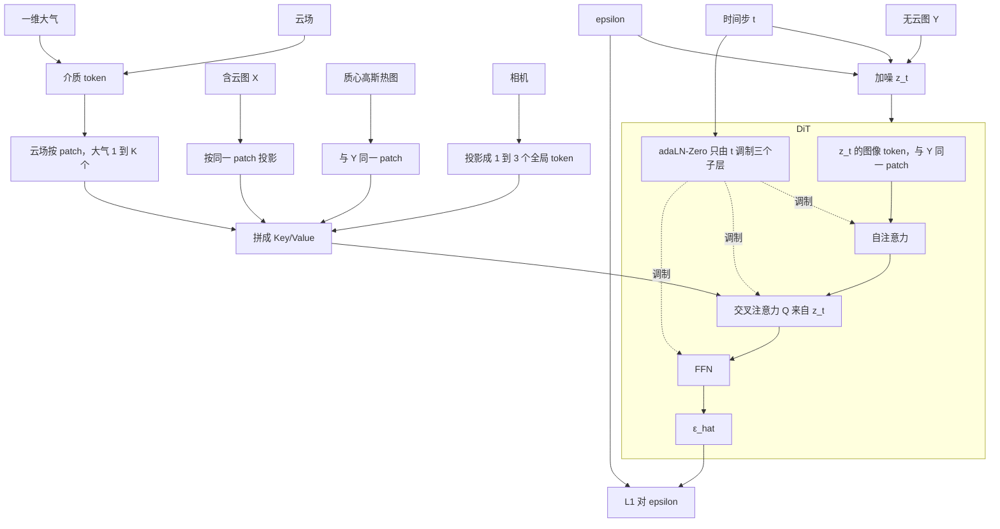

# 条件扩散：由含云图等条件重建无云 DN

加噪对象是无云图 \(Y\)，不是含云图 \(X\)。\(X\)、目标先验、相机、散射介质都是条件。时间步随机，adaLN-Zero 只由 \(t\) 调制。推理用 DDIM，条件全程固定，得到一张确定的 \(\hat Y\)。

当前合成数据里的目标是一块无纹理矩形。在质心周围做卷积得到的 9×9 是常数，没有散射中心、阴影或轮廓，不能叫做 SAR 切片。它不进入网络。目标先验是铺在整幅图上的高斯热图：峰值在质心，标准差取目标在行、列上的实际展宽。热图与 \(Y\) 共用 patch。有空间结构的真实 SAR 切片可以替换这张热图；在那之前，这个条件只表示目标在哪里。

## 训练与推理

推理从 \(z_T\sim\mathcal N(0,I)\) 起，DDIM 走到 \(z_0=\hat Y\)。条件仍是 \(X\)、目标先验、相机、介质，不重新抽样。

## 公式

前向只对 \(Y\) 加噪：

\[
z_t=\sqrt{\bar\alpha_t}\,Y+\sqrt{1-\bar\alpha_t}\,\varepsilon,\qquad\varepsilon\sim\mathcal N(0,I)
\]

\[
\hat\varepsilon=\mathrm{DiT}\bigl(z_t,\,t;\,\mathrm{Proj}(X),\,\mathrm{Proj}(q_{\mathrm{prior}}),\,\mathrm{Proj}(c_{\mathrm{cam}}),\,\mathrm{Proj}(c_{\mathrm{med}})\bigr)
\]

训练损失只监督噪声，不与图像损失混用：

\[
\mathcal L=\lVert\varepsilon-\hat\varepsilon\rVert_1
\]

由 \(\hat\varepsilon\) 还原的干净图只用于推理和事后查看：

\[
\hat Y_0=\frac{z_t-\sqrt{1-\bar\alpha_t}\,\hat\varepsilon}{\sqrt{\bar\alpha_t}}
\]

DDIM（确定性，不加第二路噪声）：

\[
z_{t-1}=\sqrt{\bar\alpha_{t-1}}\,\hat Y_0+\sqrt{1-\bar\alpha_{t-1}}\,\hat\varepsilon
\]

## 归一化

共用定标先把含云、无云辐亮度变成同一套 DN：短波红外 \((L-L_{\mathrm{offset}})/L_{\mathrm{scale}}\)，长波用 [`tools/radiance_to_dn.py`](../tools/radiance_to_dn.py)。两组图必须共用同一组 offset/scale。

加噪在归一化域。定标后的 DN 再除以训练集标准差，使 \(Y\) 的量级接近 1，然后 \(\varepsilon\sim\mathcal N(0,I)\)。推理得到的 \(\hat Y_0\) 乘回该标准差，回到 DN。负值只出现在中间的 \(z_t\)，不是物理数码。

## Token

\(Y\) 与 \(X\) 用同一套 patch（例如 \(16\times 16\)），序列长度都是 \(N\)，位置编码相同。第 \(i\) 个 token 在两张图上是同一块像素。\(z_t\) 的 token 来自加噪后的 \(Y\)，作为 Query。\(X\) 的 token 来自同一位置，只进入 Key/Value。

| 条件 | token 数 | 空间 |
| --- | --- | --- |
| \(X\) | \(N\) | 与 \(Y\) 同一 patch |
| 目标先验 | \(N\) | 质心高斯热图，与 \(Y\) 同一 patch |
| 相机 | 1–3 个全局 token | 无空间位置 |
| 介质 | 云场按 patch；大气 1–\(K\) 个 | 云场与 patch 对齐，大气是全局廓线 |

Key/Value 长度是 \(N+N+N_{\mathrm{cam}}+N_{\mathrm{med}}\)。四路先各自线性投影到同一宽度，再拼接。adaLN-Zero 的 \(\gamma,\beta,\alpha\) 只来自 \(t\) 的嵌入，调制自注意力、交叉注意力和 FFN，不接收相机。高斯画在质心像素上。世界坐标与该像素是同一点，只随热图的位置进入网络，不再另做一次向量相加。
